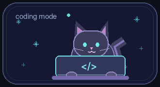
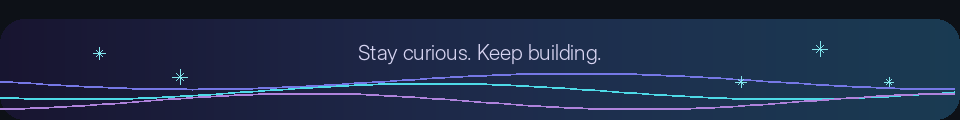

 

 

### A little about me

Hi, I'm **Tuğba**, a software developer with around **4 years of professional experience**. I've worked on CRM/ERP systems and fintech projects, primarily building APIs and backend services.

I care about thoughtful architecture, maintainable code, and making complicated workflows easier to work with. Lately, I've also been learning more about **application security** and exploring ideas for **AI-powered products**.

### Technologies I use

  

### What I'm exploring

- Application and API security
- AI-powered products
- Software architecture and distributed systems
- Technical writing

### Find me here

&nbsp;&nbsp;

  

